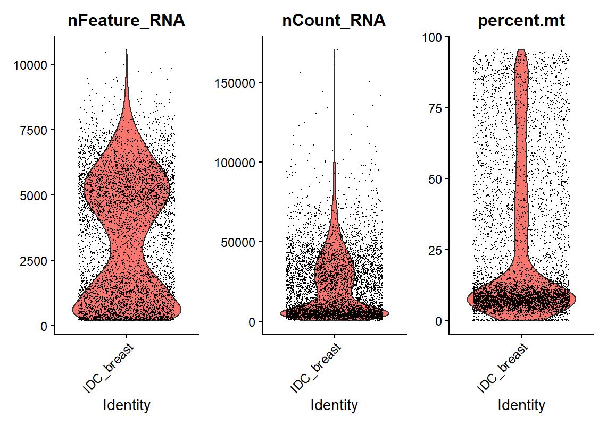
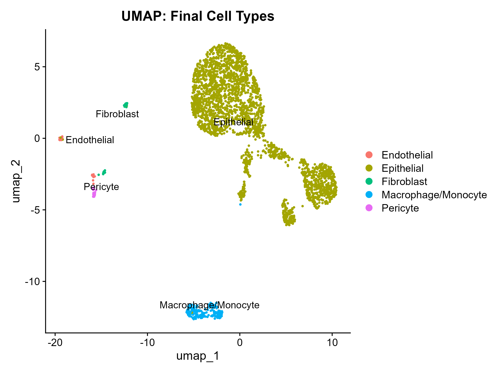
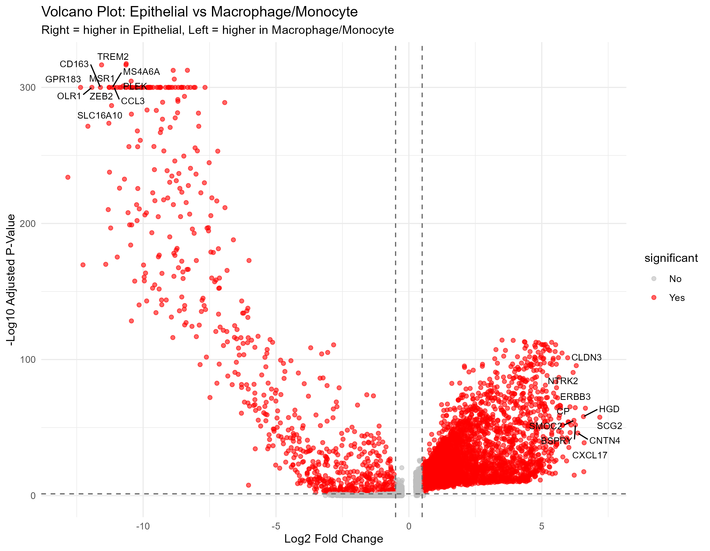
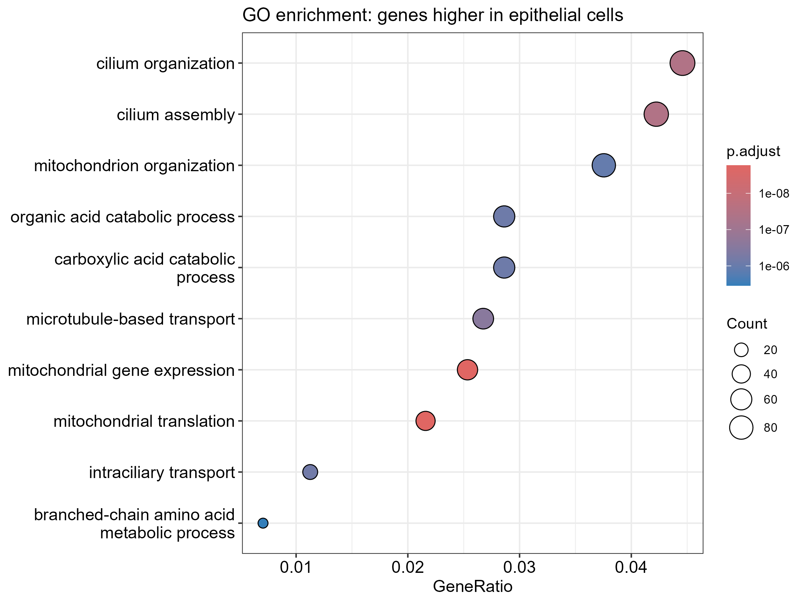
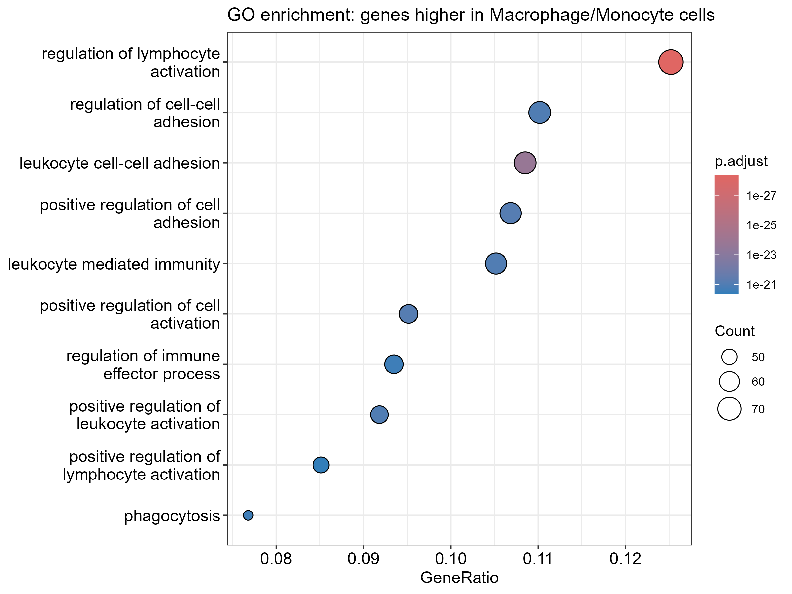

# Single-cell RNA-seq analysis of human invasive ductal carcinoma

## Summary
End-to-end scRNA-seq analysis of a human breast tumour in R (Seurat):
quality control, clustering, cell type annotation, differential expression
between cell types, and pathway enrichment. Completed as a capstone project.

## Data
- Dataset: 7.5k Sorted Cells from Human Invasive Ductal Carcinoma, 3' v3.1
  (Universal 3' dataset analysed with Cell Ranger 6.0.0), 10x Genomics
- Link: https://www.10xgenomics.com/datasets/7-5-k-sorted-cells-from-human-invasive-ductal-carcinoma-3-v-3-1-3-1-standard-6-0-0 
- File used: filtered feature-barcode matrix
- The data are not included in this repository; download them from the link above.

## Methods
| Step | Tool / setting |
|---|---|
| QC filters | 200-9,000 genes per cell, <15% mitochondrial reads |
| Normalisation | LogNormalize, scale factor 10,000 |
| Variable genes | 2,000 (vst) |
| Dimensionality reduction | PCA (first 15 PCs), UMAP |
| Clustering | Graph-based, resolution 0.6, seed 1234 |
| Annotation | SingleR (Human Primary Cell Atlas), checked against cluster marker genes |
| Differential expression | Seurat FindMarkers: Epithelial vs Macrophage/Monocyte |
| Pathway analysis | GO biological process enrichment (clusterProfiler) |

## Results
- 4,972 cells loaded; 2,949 retained after QC
- 11 clusters grouped into five cell populations:

| Cell type | Cells |
|---|---|
| Epithelial (tumour) | 2,617 |
| Macrophage/Monocyte | 202 |
| Fibroblast | 51 |
| Endothelial | 49 |
| Pericyte | 30 |

- The epithelial group combines seven clusters, including one made up of
  dividing cells (high TOP2A, UBE2C, CENPF).
- Genes higher in macrophages/monocytes included TREM2, CD163, MSR1 and MS4A6A.
  Genes higher in epithelial cells included CLDN3, ERBB3 and CXCL17.
- GO enrichment: macrophage-side genes were strongly enriched for immune
  processes (leukocyte activation, cell adhesion, phagocytosis). Epithelial-side
  genes showed a weaker, broader signal (mitochondrial, metabolic and
  cilium-related processes).

## Limitations
- Single sample, so results are descriptive and cannot be generalised.
- Cells are treated as replicates, which inflates statistical significance.
- The sample was sorted, so cell proportions may not reflect the whole tumour,
  and almost no lymphocytes were detected.
- The smallest groups (about 30-50 cells) give less stable results.
- SingleR labelled the 30-cell pericyte cluster as Tissue_stem_cells (the
  reference has no pericyte category); its top marker genes (COX4I2, HIGD1B,
  NDUFA4L2, ACTA2) indicate pericytes.
- Pathway results are exploratory.

## Output files
- `analysis_script.R`: full analysis script
- `plots/`: figures
- `cluster_markers_all.csv`, `cluster_markers_top10.csv`: cluster marker genes
- `Epithelial_vs_Macrophage_DEGs.csv`: differential expression results
- `session_info.txt`: R and package versions

## How to run
1. Download the data and place it in `raw_data/`.
2. Install: Seurat, dplyr, ggplot2, ggrepel, patchwork, SingleR, celldex, RColorBrewer,clusterProfiler, enrichplot, org.Hs.eg.db.
3. Open the project in RStudio and run `analysis_script.R`.

## Credit
Completed as a capstone for "Master Single-Cell RNA-seq Analysis from Scratch
Using R, Python, and Cloud Tools - Master QC, Clustering and Annotation"
on Udemy (Rafiq Ur Rehman). Analysis by Jessica Ogan.
